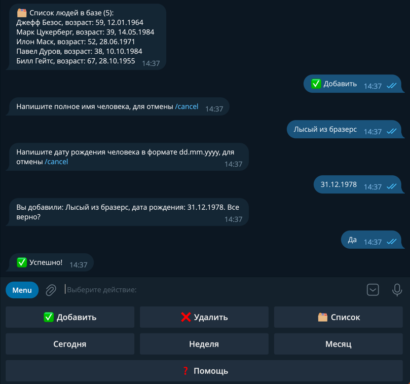

[](https://github.com/astral-sh/uv)
[](https://github.com/astral-sh/ruff)

# Birthdaygram - telegram bot for birthday reminders


## Information

### Description

This project contains an asynchronous telegram bot interface to easily manage the birthdays of your family, friends and acquaintances.

### Features

- All telegram users who use the bot has their own database table and can manage only their own list by the telegram bot interface.
- Easy add or remove persons to your personal list.
- View your entire personal list of people.
- Ability to see who has a birthday today, within a week or within a month.
- A scheduler that will run at the specified time then the bot starts checking all users for the presence of people whose birthday is today and exactly 7 days later, after which it sends a message with a reminder of this.
- Fully asynchronous.



### Author
Ilya Malashenko (github: melax08)

### System requirements
- Python 3.14;
- Docker (20.10+) with docker compose for easy run;
- [uv](https://docs.astral.sh/uv/).

### Tech stack
[![Python][Python-badge]][Python-url]
[![Python-telegram-bot][Python-telegram-bot-badge]][Python-telegram-bot-url]
[![Postgres][Postgres-badge]][Postgres-url]
[![SQLAlchemy][SQLAlchemy-badge]][SQLAlchemy-url]
[![uv][uv-badge]][uv-url]

## Installation and start
<details>
<summary>
Via docker
</summary>

Clone the repo and change directory to it:
```shell
git clone https://github.com/melax08/birthdaygram.git
```
```shell
cd birthdaygram
```

Copy file `.env.example` to `.env` and fill it in
```shell
cp .env.example .env
nano .env
```

Run `docker compose` to create needed containers:
```shell
docker compose -f infra/docker-compose.yml up -d
```

</details>

## Settings and documentation

All bot constants you can find in `src/bot/constants/constants.py`.
Some of them you can set in `.env` file (see example in `.env.example` file).

<details>
<summary>
Scheduler settings
</summary>
<br>

At the specified time, the scheduler runs a task to check all tables in the database for records of people whose birthday is today or exactly 7 days from now. Those who have these people added to the database will receive a telegram message with information about birthdays.

You can set a `RUN_SCHEDULER_HOURS` constant in the file .env.
Example:

```shell
RUN_SCHEDULER_HOURS=12 18
```

The scheduler tasks will be added to the queue when the bot starts.
In this example, the scheduler will run at 12:00 (12:00 AM) and 18:00 (6:00 PM)

If you set `RUN_SCHEDULER_HOURS` to the empty value (`RUN_SCHEDULER_HOURS=`), the scheduler will not work.

</details>

### For developers

Use `pre-commit` to automatic application of `ruff` and other pre-commit hooks.

```shell
pre-commit install
```

<!-- MARKDOWN LINKS & BADGES -->
[Python-url]: https://www.python.org/
[Python-badge]: https://img.shields.io/badge/Python-376f9f?style=for-the-badge&logo=python&logoColor=white
[Python-telegram-bot-url]: https://github.com/python-telegram-bot/python-telegram-bot
[uv-badge]: https://img.shields.io/endpoint?url=https://raw.githubusercontent.com/astral-sh/uv/main/assets/badge/v0.json
[uv-url]: https://docs.astral.sh/uv/
[Python-telegram-bot-badge]: https://img.shields.io/badge/python--telegram--bot-4b8bbe?style=for-the-badge
[Postgres-url]: https://www.postgresql.org/
[Postgres-badge]: https://img.shields.io/badge/postgres-306189?style=for-the-badge&logo=postgresql&logoColor=white
[SQLAlchemy-url]: https://www.sqlalchemy.org
[SQLAlchemy-badge]: https://img.shields.io/badge/sql-alchemy-red?style=for-the-badge
